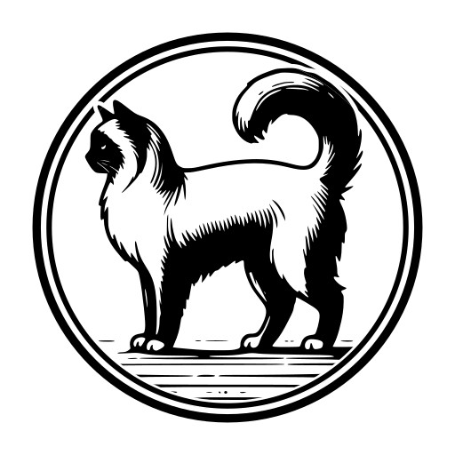

# Ella MOCN (alpha)

  

**Ella MOCN** integrates your neutral host radio network with mobile operators. It is a Multi-Operator Core Network (MOCN) gateway: your radios connect to Ella MOCN, and Ella MOCN connects them to each operator's core.

[Get Started Now!](https://docs.ellanetworks.com/mocn/tutorials/connect_your_first_radio/)

## Key Features

- **Multi-Operator**: Share one 4G and 5G radio network between several operators. Radios connect to Ella MOCN, and each operator sees a single base station.
- **4G and 5G Compliant**: Ella MOCN integrates with 4G and 5G networks following 3GPP standards. It has been validated with commercial radios, phones and cores.
- **User-Plane Aggregation**: Optionally carry subscriber traffic through Ella MOCN's eBPF-based data plane, so Ella MOCN acts as a single point of contact for operators.
- **Lightweight**: A single binary with an embedded UI, API and database. Install with snap, Docker or Kubernetes, or from source.
- **Single Sign-On**: Users log in through an identity provider, such as Google, Microsoft or Okta, over OpenID Connect.
- **Easy to Operate**: Manage operators and radios through a web interface or a RESTful API with an OpenAPI specification. Monitor every radio, MME and AMF, and each operator's traffic, with logs, metrics (Prometheus), traces (OTel) and profiles.

## Quick Links

- [Website](https://ellanetworks.com/)
- [Documentation](https://docs.ellanetworks.com/mocn/)
- [Snap Store Listing](https://snapcraft.io/ella-mocn)
- [Ella Core](https://github.com/ellanetworks/core)
- [Contributing](CONTRIBUTING.md)

## License

Ella MOCN is licensed under Business Source (BUSL-1.1).

You need a [Production License](https://ellanetworks.com/pricing) to run Ella MOCN in production. For more information, view our [License FAQ](https://ellanetworks.com/license-faq).
